Software engineer. I build backend systems and developer tooling, and I enjoy customising my Linux desktop (KDE Plasma).

## Projects

<!-- projects:start -->
<b>Code navigation</b>

<a href="https://github.com/Aethryl/ty-agent-lsp"><picture><source media="(prefers-color-scheme: dark)" srcset="cards/ty-agent-lsp-dark.svg">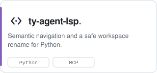</picture></a>
<a href="https://github.com/Aethryl/lsp-guard"><picture><source media="(prefers-color-scheme: dark)" srcset="cards/lsp-guard-dark.svg"></picture></a>

<b>Usage and operations</b>

<a href="https://github.com/Aethryl/claude-usage-guard"><picture><source media="(prefers-color-scheme: dark)" srcset="cards/claude-usage-guard-dark.svg">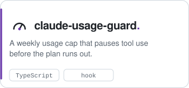</picture></a>
<a href="https://github.com/Aethryl/orca-fleet-stats"><picture><source media="(prefers-color-scheme: dark)" srcset="cards/orca-fleet-stats-dark.svg">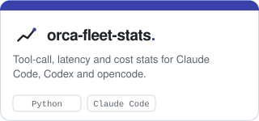</picture></a>
<a href="https://github.com/Aethryl/kowalski-analysis"><picture><source media="(prefers-color-scheme: dark)" srcset="cards/kowalski-analysis-dark.svg"></picture></a>

<b>Documents</b>

<a href="https://github.com/Aethryl/pressroom"><picture><source media="(prefers-color-scheme: dark)" srcset="cards/pressroom-dark.svg">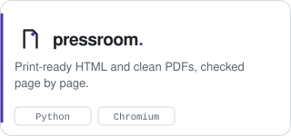</picture></a>

<b>Linux desktop</b>

<a href="https://github.com/Aethryl/plasma-setup"><picture><source media="(prefers-color-scheme: dark)" srcset="cards/plasma-setup-dark.svg">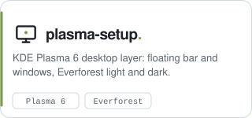</picture></a>
<a href="https://github.com/Aethryl/plasma-statusbar"><picture><source media="(prefers-color-scheme: dark)" srcset="cards/plasma-statusbar-dark.svg">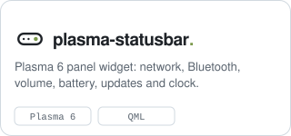</picture></a>
<a href="https://github.com/Aethryl/plasma-sysbar"><picture><source media="(prefers-color-scheme: dark)" srcset="cards/plasma-sysbar-dark.svg">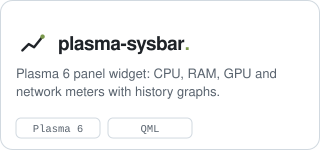</picture></a>
<a href="https://github.com/Aethryl/plasma-soundbar"><picture><source media="(prefers-color-scheme: dark)" srcset="cards/plasma-soundbar-dark.svg">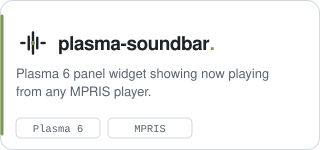</picture></a>
<a href="https://github.com/Aethryl/plasma-claudebar"><picture><source media="(prefers-color-scheme: dark)" srcset="cards/plasma-claudebar-dark.svg">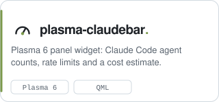</picture></a>
<a href="https://github.com/Aethryl/plasma-mural"><picture><source media="(prefers-color-scheme: dark)" srcset="cards/plasma-mural-dark.svg">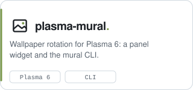</picture></a>
<a href="https://github.com/Aethryl/plasmoid-design"><picture><source media="(prefers-color-scheme: dark)" srcset="cards/plasmoid-design-dark.svg">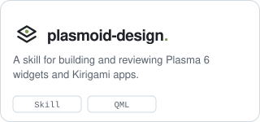</picture></a>

<!-- projects:end -->
