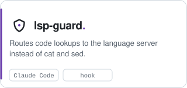
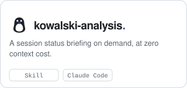

# Aethryl

Software Engineer. Backend systems, and developer tooling for Claude Code and real codebases.

## Projects

<!-- projects:start -->
<b>Code navigation</b>

<a href="https://github.com/Aethryl/ty-agent-lsp"><picture><source media="(prefers-color-scheme: dark)" srcset="cards/ty-agent-lsp-dark.svg"></picture></a>
<a href="https://github.com/Aethryl/lsp-guard"><picture><source media="(prefers-color-scheme: dark)" srcset="cards/lsp-guard-dark.svg"></picture></a>

<b>Usage and operations</b>

<a href="https://github.com/Aethryl/claude-usage-guard"><picture><source media="(prefers-color-scheme: dark)" srcset="cards/claude-usage-guard-dark.svg"></picture></a>
<a href="https://github.com/Aethryl/orca-fleet-stats"><picture><source media="(prefers-color-scheme: dark)" srcset="cards/orca-fleet-stats-dark.svg"></picture></a>
<a href="https://github.com/Aethryl/kowalski-analysis"><picture><source media="(prefers-color-scheme: dark)" srcset="cards/kowalski-analysis-dark.svg"></picture></a>

<b>Documents</b>

<a href="https://github.com/Aethryl/pressroom"><picture><source media="(prefers-color-scheme: dark)" srcset="cards/pressroom-dark.svg"></picture></a>

<!-- projects:end -->

Install any of them from Claude Code: `/plugin marketplace add Aethryl/<repo>`. Exact lines are in each README.
